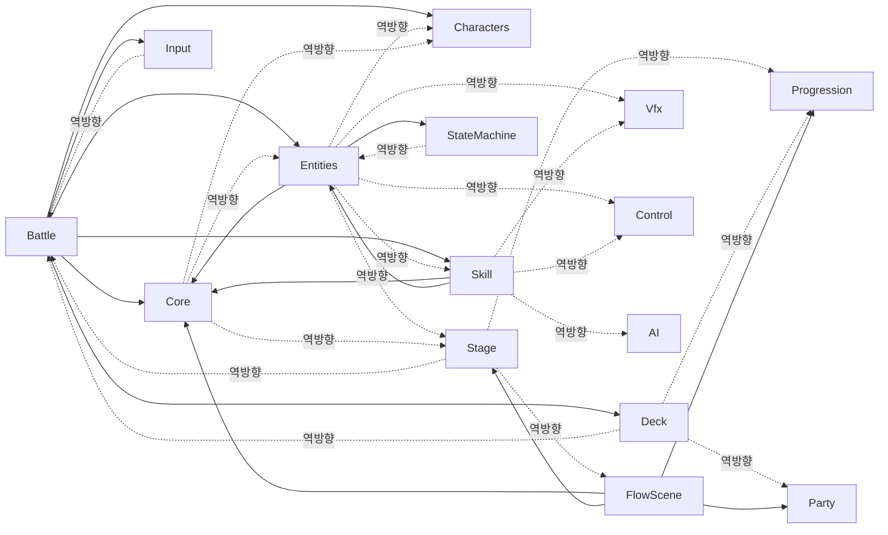
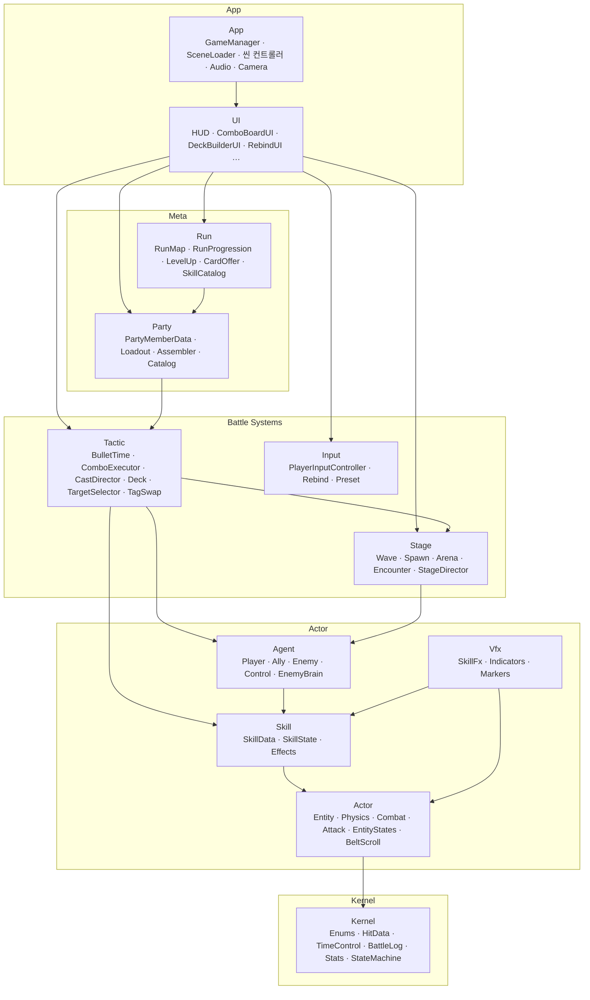

# 본게임 이식 계획 — UML 모듈 분리

작성 2026-10-16 · 기준 커밋 `7bd0591b` (Develop)

## 0. 목표와 현황

프로토타입 기능을 **모듈 단위로 떼어** 본게임으로 옮긴다. 모듈마다 UML을 먼저 그리고,
그 UML이 곧 "이 모듈이 무엇을 주고 무엇을 받는가"의 계약서가 된다.

### 지금 상태 (실측)

| 항목 | 값 |
|---|---|
| 런타임 코드 | `Assets/Scripts` 16 폴더 · 약 44,900줄 |
| 에디터 코드 | `Assets/Editor` 빌더 13 + 테스트 119 파일 |
| 네임스페이스 | 전부 `Prototype` 하나 |
| asmdef | **0개** — 전부 `Assembly-CSharp` |
| 엔진 | Unity 6000.5.5f1 · URP 17.6 · Input System 1.19 |

**폴더는 모듈이 아니다.** asmdef가 없어서 어느 폴더든 어느 폴더를 참조할 수 있었고,
실제로 순환이 많다. 폴더째 복사하면 전부 같이 딸려 온다.

### 현재 폴더 의존 (타입 참조 횟수, 스크립트로 집계)



점선이 끊어야 할 역방향 의존이다. 주요 원인:

| 역방향 | 원인 타입 (파일) |
|---|---|
| Core → Entities/Characters | `BattleRegistry`, `HitData`, `BasicAttackCombo`, `AudioManager` 가 `Entity`·`Combat`·`Ally` 를 직접 문다 |
| Core → Stage | `CameraFollow`·`CameraAnchor` 가 `StageBounds`·`CameraFrameRules` 를 문다 |
| StateMachine → Entities | `StateMachine.cs` 안에 `EntityState` 와 상태 14종(Idle~Dead)이 같이 있다 |
| Entities → Vfx | `Attack`·`Combat.Impact`·`Projectile` 이 `SkillVfx`·`BattleVfx` 를 직접 호출 |
| Entities → Skill | `SkillState`·`SkillData`·`WallFinder`·`EffectUtil` |
| Entities → Stage | `Physics`·`Projectile` 이 `GroundRegistry` 를 문다 |
| Entities → Control | `Control` 베이스, `AssistMoveState`·`AssistReadyState` |
| Skill → AI/Control | `AttackRangePreview`, `EnemyControl` |
| Deck → Battle/Progression/Party | `ComboSlot`, `ExpRules`, `PartyMemberData` |
| Stage → Progression/FlowScene | `LevelUpSession`·`MapNode`·`GameManager` |
| Input → Battle | `TargetSelector`, `BulletTimeController` (`InputMapSwitcher` 가 페이즈를 읽음) |

> 집계는 이름 매칭이라 `Entry`·`Row`·`Phase`·`Result` 같은 중첩 타입 이름은 오탐일 수 있다.
> 1단계에서 확인한다.

---

## 1. 목표 모듈 (안)

층은 아래로만 의존한다. 위층에 알려야 할 일은 **아래층이 이벤트/인터페이스를 내놓고 위층이 구독**한다.



| 모듈 | 지금 폴더 | 메모 |
|---|---|---|
| Kernel | Core(일부) · Stats · StateMachine(제네릭 부분만) | `BattleRegistry`·`Camera*`·`AudioManager`·`UiKit`·`MenuCursor` 는 내보낸다 |
| Actor | Entities + `EntityState` 14종 | `GroundRegistry` 를 인터페이스로 받는다. Vfx 호출은 `CombatEvents` 이벤트로 바꾼다 |
| Skill | Skill | Vfx 는 `SkillFxKind` 만 넘기고 재생은 Vfx 가 구독 |
| Agent | Characters + Control + AI | 셋이 서로 물려 있고 합쳐도 2,800줄. 쪼갤 이유가 없다 |
| Vfx | Vfx | 11,900줄로 최대. **가장 마지막에 옮기거나 본게임 아트로 갈아 끼울 후보** |
| Tactic | Battle(로직) + Deck | Deck ↔ `ComboSlot` 순환이라 한 모듈로 묶는다 |
| Stage | Stage | 진행(Run)에는 "클리어/실패" 이벤트만 쏜다 |
| Input | Input | `InputMapSwitcher` 는 Tactic 페이즈를 알아야 하므로 Tactic 쪽으로 옮긴다 |
| Party · Run | Party · Progression(로직) | |
| UI | Battle/Components/UI + 각 폴더의 `*UI`·`*HUD` | 본게임 UI로 **대체될 가능성 높음** — 계약만 문서화 |
| App | FlowScene + Camera · Audio | 본게임 것으로 **대체**. 이식 대상 아님 |

이 표는 1단계 UML을 그리면서 확정한다. 클래스 하나하나의 소속은 그때 정한다.

---

## 2. UML 산출물

도구: **PlantUML** (`docs/uml/*.puml`). 텍스트라 diff가 되고, VS Code · IntelliJ에서 미리보기된다. 설명은 같은 이름의 `.md`.
기존 `클래스다이어그램.canvas` 는 초기 설계도로 남겨 두고, 코드 기준 UML은 새로 그린다.

| # | 다이어그램 | 단위 | 내용 |
|---|---|---|---|
| U1 | 패키지 (As-Is) | 전체 1장 | 위 0절 그래프를 클래스 단위로 상세화 |
| U2 | 패키지 (To-Be) | 전체 1장 | 1절 그래프 확정판. 화살표는 아래로만 |
| U3 | 클래스 | 모듈당 1장 | **다른 모듈이 만지는 공개 면만** (모듈당 15개 이내). 내부 클래스는 생략 |
| U4 | 시퀀스 | 모듈당 1~2장 | 그 모듈의 대표 흐름 (아래 표) |
| U5 | 상태 | 해당 모듈만 | `EntityState` 14종, `TacticStates`, `StageDirector`, `RunMap` |
| U6 | 계약표 | 모듈당 1장 | Provides / Requires / Events / 에셋(SO·프리팹) / 정적 접근 / 테스트 |

### 모듈별 대표 시퀀스 (U4)

| 모듈 | 흐름 |
|---|---|
| Actor | 피격: `Attack` 충돌 → `Combat` 피해 → 상태 전이 → `Physics` 넉백 → 벽 바운드 |
| Skill | 시전: `SkillState` 조준 → `Fire` → `EffectRunner` → `ISkillEffect` 들 |
| Agent | 적 AI 한 틱: `EnemyBrain` → `EnemyPatternAction` → `EnemyControl` → 공격 토큰 |
| Tactic | 불릿타임: 진입 → 드로우 → 슬롯 배치 → `ComboExecutor` 실행 → 해제 |
| Stage | 웨이브: `StageDirector` → `EnemySpawnService` → 클리어 판정 |
| Run | 노드 진입 → 전투 → 보상(`CardOffer`) → 레벨업 |

### 계약표 (U6) 양식

```markdown
## Skill
- Provides: SkillData(SO), ISkillEffect, SkillState, SkillContext
- Requires: Actor(Entity, Physics, Combat), Kernel(HitData, TimeControl)
- Events out: SkillFxRequested(SkillFxKind, pos)   ← Vfx가 구독
- Assets: Assets/Skills/*.asset (SkillData 전부), Resources: 없음
- Static access: (없어야 정상 — 있으면 여기 적는다)
- Tests: SkillState*, Effects*, ...
```

U3 클래스 다이어그램은 손으로 처음부터 그리지 않는다. 0절에서 쓴 의존 집계 스크립트를
확장해 폴더별 `classDiagram` 뼈대(공개 멤버 + 상속 + 참조)를 뽑고, 사람이 공개 면만 남긴다.

---

## 3. 단계

### P0. 결정 (착수 전)

- 본게임 프로젝트의 엔진/URP/Input System 버전 — 프로토타입과 같은가
- **가져갈 모듈 목록** — App·UI·Vfx 는 대체 후보. 테스트용(`CastTester`·`TrainingDummy`) 제외
- 본게임 네임스페이스 이름
- 프로토타입 동결: 태그 `proto-final`

### P1. As-Is UML (U1)

현재 코드 그대로 그린다. 역방향 의존 표(0절)를 클래스 단위로 확정하고 오탐을 걸러낸다.

### P2. To-Be 설계 (U2 · U3 · U5 · U6)

모듈별로 순환 끊는 방법을 정한다. 수단은 세 가지뿐이다:

1. **옮긴다** — 잘못된 폴더에 있는 클래스 (예: `EntityState` → Actor, `InputMapSwitcher` → Tactic)
2. **이벤트로 뒤집는다** — 아래가 위를 호출하는 곳 (예: `Attack` → `BattleVfx` 를 `CombatEvents` 구독으로)
3. **인터페이스를 아래층에 둔다** — 아래가 위의 데이터를 읽는 곳 (예: `GroundRegistry` → Actor의 `IGround`)

### P3. 프로토타입 안에서 asmdef 분리

**본게임에 옮기기 전에 여기서 먼저 쪼갠다.** asmdef를 붙이면 숨은 의존이 전부 컴파일 에러로
드러나고, 119개 EditMode 테스트가 그대로 회귀 검사가 된다
(`Assets/Editor/Tests` 는 auto-referenced asmdef를 볼 수 있다).

순서는 아래층부터 — 한 모듈 = 한 PR:

```
Kernel → Actor → Skill → Agent → Vfx → Tactic → Stage → Input → Party → Run → (UI · App)
```

모듈 하나마다:

1. `Prototype.<모듈>.asmdef` 추가, 위층 참조 없이 컴파일될 때까지 P2 설계대로 수정
2. 네임스페이스 `Prototype.<모듈>` 로 변경
3. 테스트 통과 + 씬 재생 확인
4. U3/U6 문서를 실제 결과로 갱신

분리가 끝나면 CLAUDE.md의 "테스트는 `Assets/Editor/Tests` 에만" 제약이 풀린다 —
모듈별 테스트 asmdef로 옮길 수 있다.

### P4. 본게임으로 복사

모듈 폴더를 **`.meta` 포함으로** 복사한다. 순서는 P3와 같다.
모듈마다 그 모듈이 쓰는 에셋(SO · 프리팹 · anim · controller)을 같이 옮기고,
본게임에 빈 스모크 씬 하나를 만들어 확인한다.

### P5. 본게임 연결

App · UI 를 본게임 것으로 연결한다. U6 계약표의 Provides/Events 가 연결 지점 목록이다.

---

## 4. 반드시 지킬 것 (사고 지점)

| 위험 | 내용 | 대응 |
|---|---|---|
| **`[SerializeReference]` 데이터 깨짐** | `SkillData.effects` (`SkillData.cs:150`) 는 에셋에 `클래스·네임스페이스·어셈블리 이름`을 저장한다. asmdef로 옮기거나 네임스페이스를 바꾸면 모든 스킬 에셋의 효과 목록이 전부 사라진다 | 모든 `ISkillEffect` 구현에 `[MovedFrom(true, "Prototype", "Assembly-CSharp", "<옛클래스>")]` 를 붙이고, 에셋을 한 번 다시 저장한 뒤 떼어낸다 |
| 스크립트 GUID | 프리팹·씬·SO는 `.cs.meta` 의 GUID로 스크립트를 문다 | `.cs` 를 새로 만들지 말고 **`.meta` 째 복사**. 파일명 == 클래스명 유지 |
| `Resources` 경로 | `VfxLibrary`, `SkillCatalog`, `PartyCatalog` 가 `Resources.Load` 로 찾는다 | 본게임에도 같은 `Resources` 하위 경로로 두거나, 계약표에 "Requires" 로 적고 주입으로 바꾼다 |
| 정적 접근 | `PlayerInputController.Instance` 등 `.Instance`/`Find*` 가 31파일 75곳 | 숨은 의존이다. U6 "Static access" 칸에 전부 적는다 |
| 에디터 빌더 | 13개 중 씬/프리팹 생성기는 산출물이 커밋돼 있음 (`Builder_Refactor_Plan.md`) | 아트 임포트 파이프라인만 가져간다 |
| 레이어/태그 | `Wall` 레이어, `CombatLayers` | ProjectSettings 레이어 번호를 본게임과 맞춘다 |
| 입력 에셋 | `InputSystem_Actions.inputactions` | Input 모듈과 함께 이동. 액션 이름이 `InputNames.cs` 에 하드코딩 |

---

## 5. 참고 자료 (이미 있는 것)

- `docs/*_Refactor_Plan.md` — 폴더별 리팩토링 분석. P2 설계의 출발점
- `클래스다이어그램.canvas` · `클래스구조.canvas` — 초기 설계도
- `md/00~08` — 기획 다이어그램 해설
- `Assets/Scripts/README.md` — 좌표 규약 · 입력 규칙 · 시간 제어. 본게임에도 그대로 적용되는 규칙
